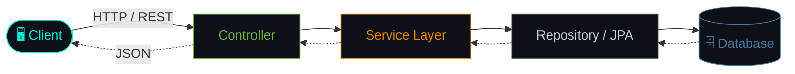

<div align="center">

[%3B;Spring+Boot+%7C+Hibernate+%7C+REST+APIs;while(alive)+%7B+learn()%3B+code()%3B+ship()%3B+%7D)](https://git.io/typing-svg)


</div>

<br/>

<table>
<tr>
<td width="34%" align="center" valign="middle">


**`< Shubham />`**

</td>
<td width="66%" valign="top">

```java
public class Developer {

    String name      = "Shubham Vijaykumar Biradar";
    String role      = "Associate Software Engineer";
    String company   = "TestYantra Software Solution";
    String location  = "Pune, Maharashtra, India";

    String[] stack   = { "Java", "Spring Boot", "Hibernate/JPA",
                         "REST APIs", "MySQL", "PostgreSQL" };

    String currently = "Building Spring Boot projects";
    String learning  = "Spring Boot, Hibernate, Microservices";

    String contact   = "shubhambiradar0812@gmail.com";

    public String motto() {
        return "Always learning, always shipping.";
    }
}
```

</td>
</tr>
</table>

<br/>

## 💻 `~/terminal`

```bash
shubham@dev:~$ cat about.txt
🔭  Associate Software Engineer @ Test Yantra Software Solution
🎯  Focus   → Java Backend · Spring Boot · MVC Architecture
🌱  Growing → Hibernate/JPA · Spring Framework · REST APIs
💬  Ask me about Java, Advanced Java, JPA, Spring & APIs
🎓  Mission → learn from mistake develop with improvements

shubham@dev:~$ echo $FUN_FACT
Coffee ☕ + Java ☕ = my favorite development environment
```

<br/>

## 🧰 `pom.xml` → Tech Stack

<div align="center">


</div>

<br/>

## 🏗️ How I Structure a Backend



<br/>

## 📸 `git log --faces`

<div align="center">
<table>
<tr>
<td align="center"><br/><sub><code>commit: confident</code></sub></td>
<td align="center"><br/><sub><code>commit: always smiling</code></sub></td>
<td align="center"><br/><sub><code>commit: ready to ship</code></sub></td>
</tr>
</table>
</div>

<br/>

## 📊 `git stats`

<div align="center">


</div>

<br/>

## 📡 `ping shubham`

<div align="center">

<a href="mailto:shubhambiradar0812@gmail.com"></a>
<a href="https://www.instagram.com/shubhambiradar0812"></a>
<a href="https://www.facebook.com/shubham-biradar"></a>
<a href="https://www.youtube.com/channel/ucufadltt6unb35qcrurlbaa"></a>

<br/><br/>

```java
if (youNeedABackendDev || youWantToCollaborate) {
    shubham.reply("Let's build something great! 🚀");
}
```

</div>


